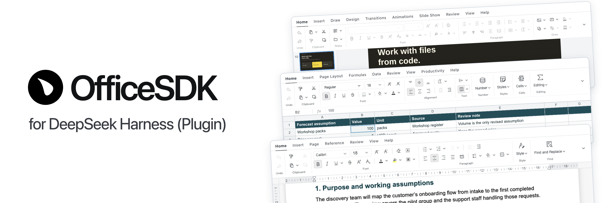
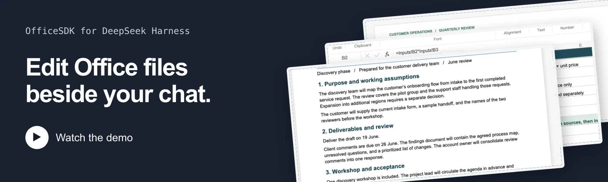
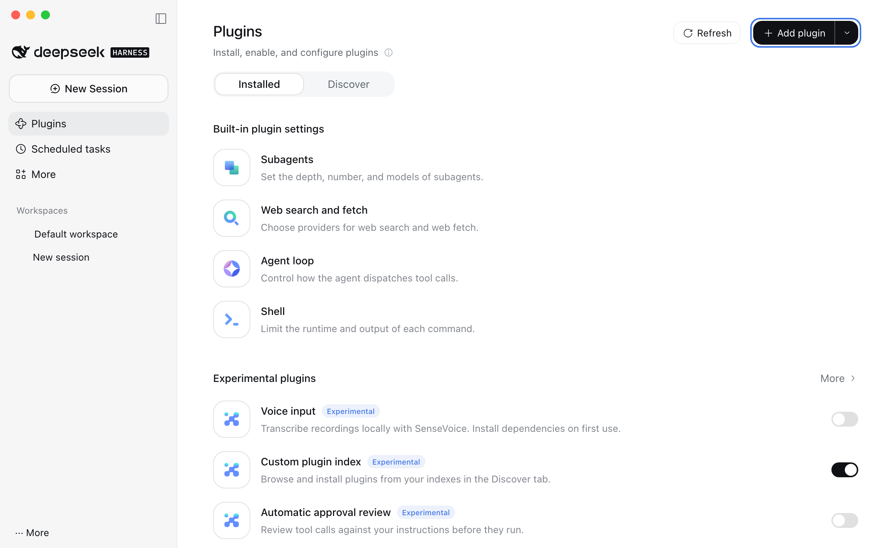
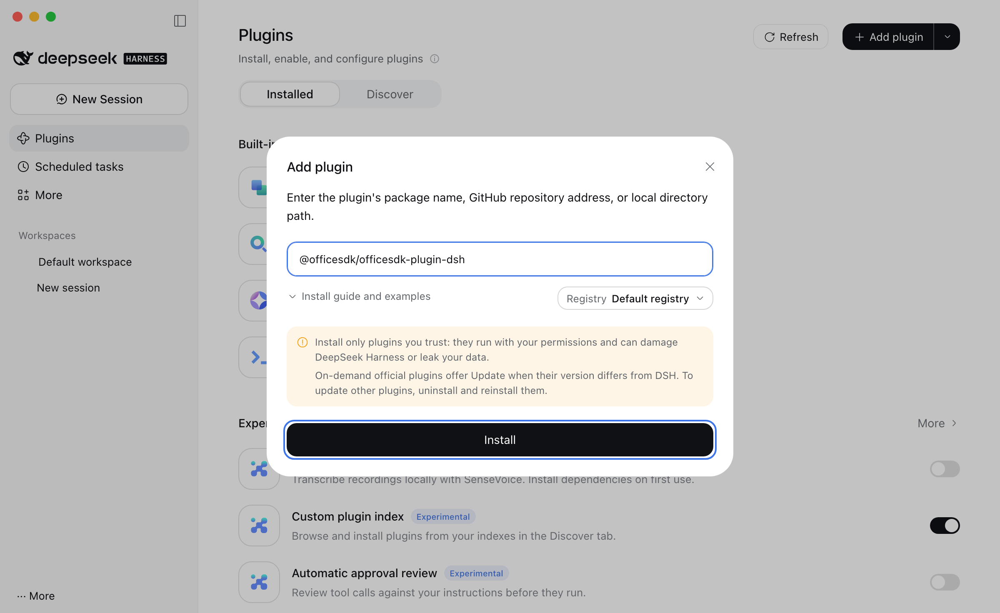
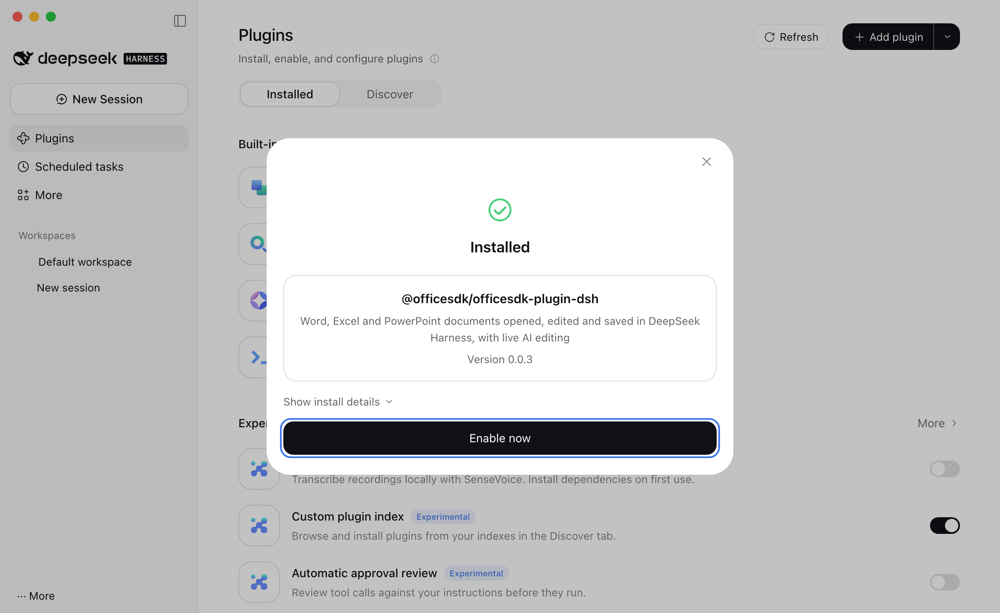
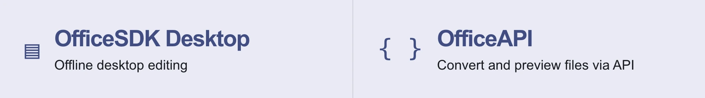

<a id="readme-top"></a>

<p align="center"></p>

<h1 align="center">Edit Office files directly in DeepSeek Harness</h1>

<p align="center">Install the OfficeSDK plugin, then open a Word document, Excel workbook, or PowerPoint presentation.</p>

<p align="center"><a href="#quick-start">🚀 Quick start</a> · <a href="https://officesdk.com/en/features">✨ Features</a> · <a href="https://officesdk.com/en">🌐 Website</a> · <a href="#examples">🎮 Demo</a> · <a href="https://officesdk.com/en/blog">📝 Blog</a></p>

<p align="center"><strong>English</strong> · <a href="./README.zh-CN.md">简体中文</a></p>

<p align="center">
<a href="https://github.com/officesdk/officesdk-plugin-dsh/releases"></a>
<a href="https://officesdk.com/en/install/deepseek-harness"></a>
<a href="https://github.com/officesdk/officesdk-plugin-dsh/blob/main/LICENSE"></a>
<a href="https://officesdk.com/legal/eula"></a>
</p>

<p align="center">
<a href="https://www.youtube.com/channel/UCxtU8aZIS42F7-FCYkFb_Kg"></a>
<a href="https://x.com/officesdk"></a>
</p>

<details>
<summary>Table of contents</summary>

- [💡 What is OfficeSDK for DeepSeek Harness (Plugin)?](#overview)
  - [Editor features](#editor-capabilities)
  - [Confirming and undoing AI edits](#ai-edits)
  - [Create files with bundled skills](#bundled-skills)
  - [Plugin demo](#examples)
- [🚀 Get started in DeepSeek Harness](#quick-start)
  - [Install from the desktop app](#desktop-install)
  - [Install from the terminal](#terminal-install)
  - [First use and updates](#first-open)
- [🌐 OfficeSDK ecosystem](#family)
- [📚 Plugin developer guides](#docs)
- [💬 Community and feedback](#community)
- [📄 License](#license)

</details>

<a id="overview"></a>

## 💡 What is OfficeSDK for DeepSeek Harness (Plugin)?

**OfficeSDK for DeepSeek Harness (Plugin)** adds native editors for Word documents, Excel workbooks, and PowerPoint presentations to DeepSeek Harness. You can change the content and formatting, then save your edits to the original file without opening a separate Office desktop app.

<a id="editor-capabilities"></a>

### Editor features

Across the plugin’s three editors, you can access **233 features** directly from the ribbon.

- **Word · 81 features.** Format paragraphs, insert footnotes, and review tracked changes.
- **Excel · 64 features.** Set up data validation, use PivotTables, and freeze the header row so it stays visible as you scroll.
- **PowerPoint · 88 features.** Change slide layouts, apply transitions, and use Presenter View.

The count for [version 0.0.3](https://github.com/officesdk/officesdk-plugin-dsh/releases/tag/v0.0.3) covers top-level ribbon controls and excludes individual spreadsheet functions and submenu options. The totals may change as we continue to update the editors.

You and your AI agent can edit the same file. You can ask the agent to revise a paragraph, update a range of cells, or edit a particular text box on a slide. For example, select the concluding paragraph of a Word document and ask the agent to shorten it while you check the figures in an earlier paragraph. You can review each change right where it was made.

| File type | Example request | What to check in the editor |
| --- | --- | --- |
| Word (`.docx`) | Shorten the final paragraph of the monthly report to two sentences. | Read the revised paragraph in context. Check its spacing or review the tracked changes. |
| Excel (`.xlsx`) | In the variance column, subtract budgeted spending from actual spending using a formula. | Select a cell to check its formula, then format the amounts to two decimal places. |
| PowerPoint (`.pptx`) | Rewrite the title of slide 3 so it states the decision we need to make at this meeting. | Check how the title wraps, reposition the text box if needed, and preview the slide. |

<a id="ai-edits"></a>

### Confirming and undoing AI edits

Enable both **OfficeSDK** and **[OfficeSDK · model editing tools](https://github.com/officesdk/officesdk-plugin-dsh/tree/main/packages/dsh-adapter/src/tools)** on the plugin page. The agent asks for confirmation before applying changes to an existing file. Each change appears in the file tab beside your conversation. When the agent creates a new document or presentation, you can watch each section or slide appear and stop the agent at any time.

You can undo the agent’s edits to a PowerPoint presentation. In Word and Excel, stopping the agent or encountering an error does not automatically undo edits it has already applied. Review those edits in the editor before saving to the original file.

<a id="bundled-skills"></a>

### Create files with bundled skills

The **OfficeSDK · Default style skills** component includes two skills. DeepSeek Harness selects the appropriate one when you ask the agent to create a file.

- **Word** (`shimo-docx`). Ask for meeting minutes, a weekly report, a product requirements document, a project plan, a proposal, a formal letter, or a blank document. The editor writes a section at a time and fills meeting decisions, milestones and proposal budgets in place. The original Chinese official-document style is also available.
- **PowerPoint** (`shimo-pptx`). Choose a work update or retrospective, training and knowledge sharing, a blank slide, or the original blue presentation style. Watch the slides fill in and return to a report in progress to see which pages are ready. Work reports can include an editable doughnut chart.

For **Excel**, open an existing workbook and ask the agent to enter data or write formulas. The plugin does not currently include a skill or template for creating new workbooks in the editor.

<details>
<summary>Upgrading from older skills</summary>

If you installed `dsh-docx-style` or `dsh-pptx-style` manually, the old skills will appear alongside the bundled ones after you upgrade. You can remove the manually installed copies. If you previously disabled the skills component, it stays disabled after the upgrade.

</details>

<a id="examples"></a>

### Plugin demo

<video controls playsinline preload="metadata" width="960" src="https://officesdk.com/sites/lusion/demo-v1/officesdk-demo-1.0-en-academic-v2.mp4" poster="https://officesdk.com/sites/lusion/demo-v1/officesdk-plugin-opening.png"></video>

<p align="center"><a href="https://officesdk.com/sites/lusion/demo-v1/officesdk-demo-1.0-en-academic-v2.mp4"></a></p>

[Watch the English demo on YouTube](https://www.youtube.com/watch?v=D8GwrO1wnWc)

<p align="right"><a href="#readme-top"></a></p>

<a id="quick-start"></a>

## 🚀 Get started in DeepSeek Harness

After installation, Office files open in a tab beside your conversation.

**Platform support.** The document engine is stable on Mac computers with Apple silicon. The x64 build for Windows is still being tested.

<a id="desktop-install"></a>

### Install from the desktop app

<table>
<thead><tr><th>Step</th><th>Action</th><th>Screenshot</th></tr></thead>
<tbody>
<tr>
<td align="center">1</td>
<td>

**Open the plugin manager**

In the sidebar, open **Plugins**. On the **Installed** tab, click **Add plugin** in the upper right.

</td>
<td><a href="./assets/en-install-open.webp"></a></td>
</tr>
<tr>
<td align="center">2</td>
<td>

**Install OfficeSDK**

Paste the package name into the **Add plugin** dialog, then click **Install**.

~~~text
@officesdk/officesdk-plugin-dsh
~~~

</td>
<td><a href="./assets/en-install-package.webp"></a></td>
</tr>
<tr>
<td align="center">3</td>
<td>

**Enable the plugin**

When the dialog says **Installed**, check the package name and version, then click **Enable now**.

</td>
<td><a href="./assets/en-install-enable.webp"></a></td>
</tr>
</tbody>
</table>

<a id="terminal-install"></a>

### Install from the terminal

In the DeepSeek Harness desktop app, select **Manage dsh Command…** to enable the `dsh` command. Quit the app, run the command below in your terminal, then reopen the app.

The command uses the runtime bundled with the desktop app. The plugin requires Node.js 22.19.0 or later. The [npm package metadata](https://registry.npmjs.org/@officesdk/officesdk-plugin-dsh/latest) lists the supported versions of DeepSeek Harness.

```sh
dsh plugin --profile desktop add @officesdk/officesdk-plugin-dsh
```

[Installation guide](https://officesdk.com/en/install/deepseek-harness)

<a id="first-open"></a>

### First use and updates

The first time you open an Office file from your workspace, the plugin downloads the [office-kit](https://github.com/officesdk/officesdk-plugin-dsh/blob/main/components/office-kit.json) document engine and editor resources for your platform. Documents render on your machine, so there is no document server to set up.

Install OfficeSDK updates from the **Plugins** panel in DeepSeek Harness.

<p align="right"><a href="#readme-top"></a></p>

<a id="family"></a>

## 🌐 OfficeSDK ecosystem

<p align="center"></p>

- **OfficeSDK Desktop** lets you edit documents offline.
- **OfficeAPI** provides a hosted API for converting and previewing documents.

<p align="right"><a href="#readme-top"></a></p>

<a id="docs"></a>

## 📚 Plugin developer guides

| Resource | Use it to |
| --- | --- |
| [Edit your first Word document](https://officesdk.com/en/docs/first-file) | Edit a paragraph in DeepSeek Harness, save the file, and reopen it to check the result. |
| [Troubleshoot the plugin](https://officesdk.com/en/help#help-fix) | Resolve problems opening a file or finding a saved copy. |
| [Plugin architecture and repository layout](https://github.com/officesdk/officesdk-plugin-dsh/blob/main/docs/OVERVIEW.md) | See how the [DeepSeek Harness adapter](https://github.com/officesdk/officesdk-plugin-dsh/tree/main/packages/dsh-adapter), [model editing tools](https://github.com/officesdk/officesdk-plugin-dsh/tree/main/packages/dsh-adapter/src/tools), and [local document engine](https://github.com/officesdk/officesdk-plugin-dsh/blob/main/components/README.md) work together. |
| [PowerPoint style template](https://github.com/officesdk/officesdk-plugin-dsh/tree/main/packages/dsh-adapter/skills/shimo-pptx/styles/default) | Customize the default [colors and fonts](https://github.com/officesdk/officesdk-plugin-dsh/blob/main/packages/dsh-adapter/skills/shimo-pptx/styles/default/style.json) and [slide layouts](https://github.com/officesdk/officesdk-plugin-dsh/blob/main/packages/dsh-adapter/skills/shimo-pptx/styles/default/template.pptx). |
| [Build and test the plugin](https://github.com/officesdk/officesdk-plugin-dsh/blob/main/docs/BUILD.md) | Build the plugin from source, run the tests, and install it in DeepSeek Harness. |
| [Release, update, and roll back](https://github.com/officesdk/officesdk-plugin-dsh/blob/main/docs/NPM.md) | Publish to npm, create a GitHub release, or roll back to an earlier version. |

<p align="right"><a href="#readme-top"></a></p>

<a id="community"></a>

## 💬 Community and feedback

- [GitHub Issues](https://github.com/officesdk/officesdk-plugin-dsh/issues) — Report a plugin bug or request a feature.
- [officesdk@shimo.im](mailto:officesdk@shimo.im) — Email us with questions or feedback.
- [YouTube](https://www.youtube.com/channel/UCxtU8aZIS42F7-FCYkFb_Kg) — Watch OfficeSDK editing walkthroughs.
- [X · @officesdk](https://x.com/officesdk) — Follow product updates.

<p align="right"><a href="#readme-top"></a></p>

<a id="license"></a>

## 📄 License

<p align="center"></p>

The [source code for the DeepSeek Harness plugin](https://github.com/officesdk/officesdk-plugin-dsh/tree/main/packages) is licensed under the MIT License. Separate license terms apply to the document engine and editor resources. [Plugin license](https://github.com/officesdk/officesdk-plugin-dsh/blob/main/LICENSE) · [Component notices](https://github.com/officesdk/officesdk-plugin-dsh/blob/main/NOTICE)

OfficeSDK Core is commercial software. Evaluation and production use require a license file or key. [Core license notice](https://github.com/officesdk/officesdk-core/blob/main/LICENSE.md) · [OfficeSDK EULA](https://officesdk.com/legal/eula)

<p align="right"><a href="#readme-top"></a></p>
