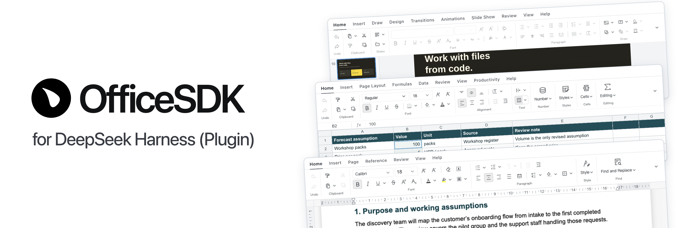
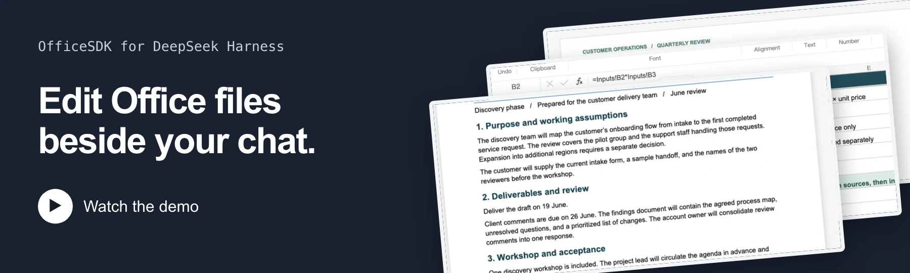
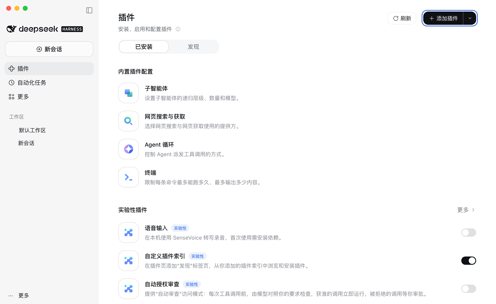
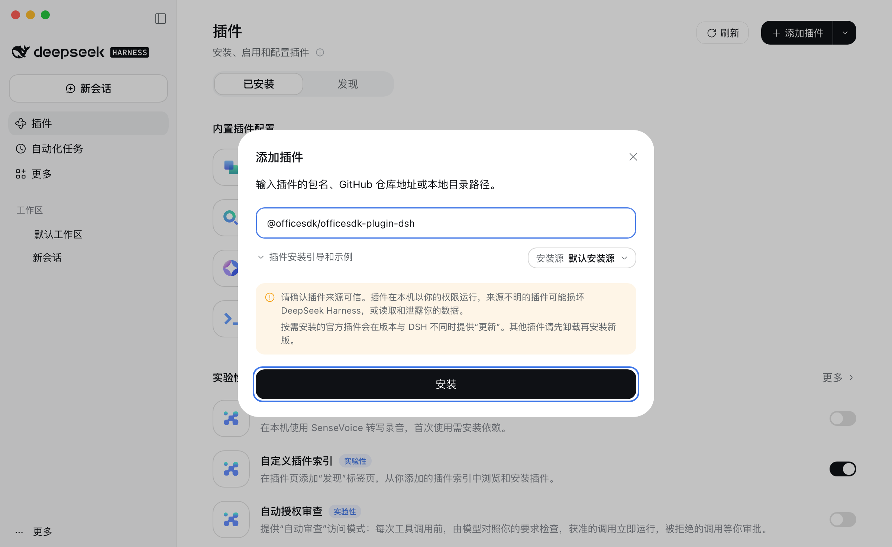
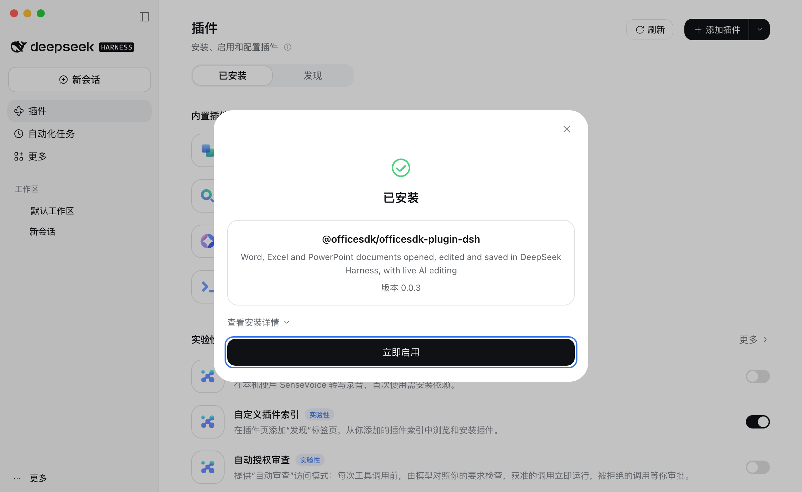
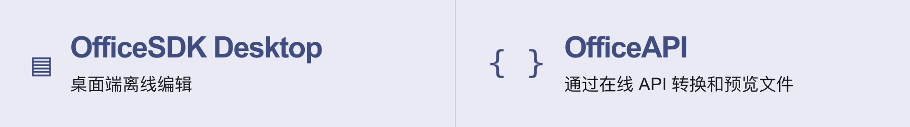

<a id="readme-top"></a>

<p align="center"></p>

<h1 align="center">用officesdk插件实现原生Office编辑体验</h1>

<p align="center">在 DeepSeek Harness 中安装插件，从一份word、excel、PowerPoint开始。</p>

<p align="center"><a href="#quick-start">🚀 快速开始</a> · <a href="https://officesdk.com/zh/features">✨ 产品功能</a> · <a href="https://officesdk.com/zh">🌐 官网</a> · <a href="#examples">🎮 演示</a> · <a href="https://officesdk.com/zh/blog">📝 博客</a></p>

<p align="center"><a href="./README.md">English</a> · <strong>简体中文</strong></p>

<p align="center">
<a href="https://github.com/officesdk/officesdk-plugin-dsh/releases"></a>
<a href="https://officesdk.com/zh/install/deepseek-harness"></a>
<a href="https://github.com/officesdk/officesdk-plugin-dsh/blob/main/LICENSE"></a>
<a href="https://officesdk.com/legal/eula"></a>
</p>

<p align="center">
<a href="https://www.youtube.com/channel/UCxtU8aZIS42F7-FCYkFb_Kg"></a>
<a href="https://x.com/officesdk"></a>
</p>

<details>
<summary>目录</summary>

- [💡 什么是 OfficeSDK for DeepSeek Harness（Plugin）？](#overview)
  - [现有编辑器能力](#editor-capabilities)
  - [确认与撤销 AI 的修改](#ai-edits)
  - [用内置 Skills 新建文件](#bundled-skills)
  - [插件演示视频](#examples)
- [🚀 在 DeepSeek Harness 中快速开始](#quick-start)
  - [从桌面端安装](#desktop-install)
  - [从命令行安装](#terminal-install)
  - [首次打开文件与后续更新](#first-open)
- [🌐 OfficeSDK 产品生态](#family)
- [📚 DSH 插件开发文档](#docs)
- [💬 社区与反馈](#community)
- [📄 许可](#license)

</details>

<a id="overview"></a>

## 💡 什么是 OfficeSDK for DeepSeek Harness（Plugin）？

**OfficeSDK for DeepSeek Harness（Plugin）** 具备在 DeepSeek Harness 里直接编辑 Word 文稿、Excel 表格和 PowerPoint 幻灯片的能力。打开文件、修改内容和格式，再保存回原文件，整个过程都不用另开 Office 桌面软件。

<a id="editor-capabilities"></a>

### 现有编辑器能力

在这款插件的编辑器中，[0.0.3 版本](https://github.com/officesdk/officesdk-plugin-dsh/releases/tag/v0.0.3)可操作 **233 项功能**（持续更新中），其中 Word 文稿 81 项、Excel 表格 64 项、PowerPoint 幻灯片 88 项。在文稿中，你可以调整段落格式、插入脚注和审阅修订。在表格中，你可以设置数据验证、使用数据透视表和冻结表头。在幻灯片中，你可以调整版式、设置切换效果和使用演示者视图。此统计覆盖功能区一级入口，未逐个计入表格函数和菜单里的详细选项。

在同一份文件里，你可以直接编辑，也可以指定 AI 修改哪段文字、哪块单元格或哪一页上的哪个文本框。比如，选中 Word 文稿的结论段让 AI 压缩篇幅，在它起草改写时继续校对前面的数据段。每处修改都可以回到原文位置核对。

| 文件 | 交给 Agent 的修改 | 在编辑器里核对 |
| --- | --- | --- |
| Word 文稿（`.docx`） | 把月报最后一段结论压缩到两句话。 | 通读上下文，调整段落间距，或查看修订。 |
| Excel 表格（`.xlsx`） | 在差额列填入「实际支出减去预算」的公式。 | 点开单元格核对公式，再把金额统一保留两位小数。 |
| PowerPoint 幻灯片（`.pptx`） | 把第 3 页标题改成这次会议需要决定的事项。 | 检查标题换行，移动文本框，再预览这一页。 |

<a id="ai-edits"></a>

### 确认与撤销 AI 的修改

使用 AI 编辑前，请在插件页启用 **OfficeSDK** 和 **[OfficeSDK · 模型编辑工具](https://github.com/officesdk/officesdk-plugin-dsh/tree/main/packages/dsh-adapter/src/tools)**。修改已有文件时，AI 会先等你确认，再把改动逐步显示在右侧文件页签中。新建文稿或幻灯片时，你可以边生成边查看，随时停止。

PowerPoint 支持撤销 AI 的修改。处理 Word 或 Excel 时，中途停止或出错都不会自动撤销已完成的修改。保存回原文件前，可以先核对这些改动。

<a id="bundled-skills"></a>

### 用内置 Skills 新建文件

插件自带两项用于新建文件的 Skills，DeepSeek Harness 会根据你的请求选用。

- **Word**（`shimo-docx`）支持会议纪要、工作周报、产品需求文档、项目计划、项目建议书、正式信函和空白文档，也保留原有公文版式。正文在右侧逐段写入，会议决定、里程碑与建议书预算表在相应位置整体呈现。
- **PowerPoint**（`shimo-pptx`）可选团队工作汇报、培训与经验分享、空白幻灯片和原有蓝色品牌风格。可以在右侧查看各页生成进度，切回汇报会话继续查看已完成页。工作汇报可包含可编辑的环形图。

**Excel** 支持让 AI 读取和修改已有工作簿。当前插件未内置 Excel 新建模板或 Skill。要让 AI 填写数据或写公式，请先打开一份现有工作簿。

<details>
<summary>从旧版 Skills 升级</summary>

如果曾手动安装 `dsh-docx-style` 或 `dsh-pptx-style`，升级后它们会与插件自带的新版 Skills 并列显示。可以移除手动安装的旧副本。原有的组件启用或停用设置会保留。

</details>

<a id="examples"></a>

### 插件演示视频

<video controls playsinline preload="metadata" width="960" src="https://officesdk.com/sites/lusion/demo-v1/officesdk-demo-1.0-en-academic-v2.mp4" poster="https://officesdk.com/sites/lusion/demo-v1/officesdk-plugin-opening.png"></video>

<p align="center"><a href="https://officesdk.com/sites/lusion/demo-v1/officesdk-demo-1.0-en-academic-v2.mp4"></a></p>

[在 YouTube 上观看英文演示](https://www.youtube.com/watch?v=D8GwrO1wnWc)

<p align="right"><a href="#readme-top"></a></p>

<a id="quick-start"></a>

## 🚀 在 DeepSeek Harness 中快速开始

安装完插件后，Office文件会在对话旁边的文件页签中打开。

**安装前确认平台。** 文档引擎在 Apple 芯片 Mac 上为稳定版，Windows x64 版仍在测试。

<a id="desktop-install"></a>

### 从桌面端安装

<table>
<thead><tr><th>步骤</th><th>操作</th><th>完整页面</th></tr></thead>
<tbody>
<tr>
<td align="center">1</td>
<td>

**打开插件管理**

在左侧栏打开 **插件**，在 **已安装** 页签右上角点击 **添加插件**。

</td>
<td><a href="./assets/zh-install-open.webp"></a></td>
</tr>
<tr>
<td align="center">2</td>
<td>

**安装插件**

在 **添加插件** 窗口粘贴包名，然后点击 **安装**。

~~~text
@officesdk/officesdk-plugin-dsh
~~~

</td>
<td><a href="./assets/zh-install-package.webp"></a></td>
</tr>
<tr>
<td align="center">3</td>
<td>

**启用插件**

窗口显示 **已安装** 后，核对 OfficeSDK 的包名和版本，点击 **立即启用**。

</td>
<td><a href="./assets/zh-install-enable.webp"></a></td>
</tr>
</tbody>
</table>

<a id="terminal-install"></a>

### 从命令行安装

在 DeepSeek Harness 桌面端菜单中选择 **Manage dsh Command…**，启用应用自带的 `dsh` 命令。完全退出桌面端，运行下面的命令，再重新打开应用。这个命令使用桌面端自带的运行环境。插件包要求 Node.js 22.19.0 或更高版本。兼容的 DSH 版本范围见 [npm 包信息](https://registry.npmjs.org/@officesdk/officesdk-plugin-dsh/latest)。

```sh
dsh plugin --profile desktop add @officesdk/officesdk-plugin-dsh
```

[完整安装指南](https://officesdk.com/zh/install/deepseek-harness)

<a id="first-open"></a>

### 首次打开文件与后续更新

第一次从工作区打开 Office 文件时，插件会下载适用于当前系统的 [office-kit](https://github.com/officesdk/officesdk-plugin-dsh/blob/main/components/office-kit.json) 文档引擎和编辑器资源。文档在本机渲染，无需单独部署文档服务器。

有新版本时，可以在 DeepSeek Harness 的 **插件** 面板中更新 OfficeSDK。

<p align="right"><a href="#readme-top"></a></p>

<a id="family"></a>

## 🌐 OfficeSDK 产品生态

<p align="center"></p>

- **OfficeSDK Desktop** 是用于离线编辑文档的桌面应用。
- **OfficeAPI** 提供文档转换和预览的在线 API。

<p align="right"><a href="#readme-top"></a></p>

<a id="docs"></a>

## 📚 DSH 插件开发文档

| 资源 | 用途 |
| --- | --- |
| [编辑第一份 Word 文稿](https://officesdk.com/zh/docs/first-file) | 在 DeepSeek Harness 中修改一段文字，保存后重新打开文件核对。 |
| [插件问题排查](https://officesdk.com/zh/help#help-fix) | 排查打开文件和保存副本时遇到的问题。 |
| [插件架构与源码目录](https://github.com/officesdk/officesdk-plugin-dsh/blob/main/docs/OVERVIEW.md) | 了解 [DSH 适配层](https://github.com/officesdk/officesdk-plugin-dsh/tree/main/packages/dsh-adapter)、[模型编辑工具](https://github.com/officesdk/officesdk-plugin-dsh/tree/main/packages/dsh-adapter/src/tools)和[本地文档引擎](https://github.com/officesdk/officesdk-plugin-dsh/blob/main/components/README.md)如何配合。 |
| [PowerPoint 样式模板](https://github.com/officesdk/officesdk-plugin-dsh/tree/main/packages/dsh-adapter/skills/shimo-pptx/styles/default) | 以默认样式为起点，自定义[配色、字体](https://github.com/officesdk/officesdk-plugin-dsh/blob/main/packages/dsh-adapter/skills/shimo-pptx/styles/default/style.json)和[版式](https://github.com/officesdk/officesdk-plugin-dsh/blob/main/packages/dsh-adapter/skills/shimo-pptx/styles/default/template.pptx)。 |
| [构建与测试](https://github.com/officesdk/officesdk-plugin-dsh/blob/main/docs/BUILD.md) | 从源码打包插件，在本地运行测试并安装到 DSH。 |
| [发布、更新与回滚](https://github.com/officesdk/officesdk-plugin-dsh/blob/main/docs/NPM.md) | 查看 npm 发布渠道、GitHub Release 和版本回滚流程。 |

<p align="right"><a href="#readme-top"></a></p>

<a id="community"></a>

## 💬 社区与反馈

- [GitHub Issues](https://github.com/officesdk/officesdk-plugin-dsh/issues) — 报告插件问题或提出功能建议。
- [officesdk@shimo.im](mailto:officesdk@shimo.im) — 通过邮件反馈使用问题或建议。
- [YouTube](https://www.youtube.com/channel/UCxtU8aZIS42F7-FCYkFb_Kg) — 观看 OfficeSDK 的文件编辑演示。
- [X · @officesdk](https://x.com/officesdk) — 关注产品更新。

<p align="right"><a href="#readme-top"></a></p>

<a id="license"></a>

## 📄 许可

<p align="center"></p>

DeepSeek Harness [插件源码](https://github.com/officesdk/officesdk-plugin-dsh/tree/main/packages)采用 MIT 许可。插件使用的文档引擎和编辑器资源各有单独的许可条款。[插件许可证](https://github.com/officesdk/officesdk-plugin-dsh/blob/main/LICENSE) · [组件许可说明](https://github.com/officesdk/officesdk-plugin-dsh/blob/main/NOTICE)

OfficeSDK Core 是商业软件。评估和生产使用均需取得许可文件或密钥。[Core 许可说明](https://github.com/officesdk/officesdk-core/blob/main/LICENSE.md) · [OfficeSDK 最终用户许可协议](https://officesdk.com/legal/eula)

<p align="right"><a href="#readme-top"></a></p>
